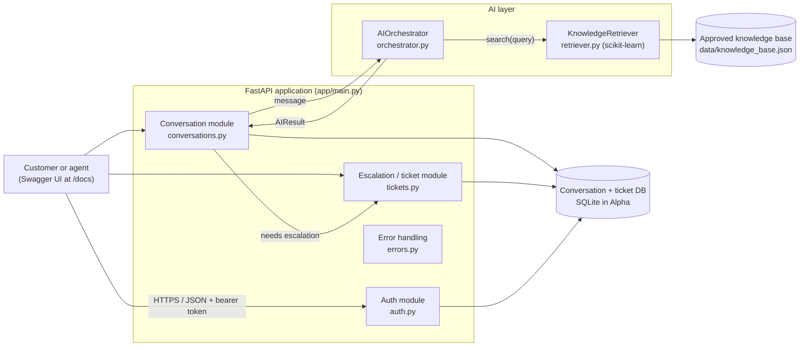
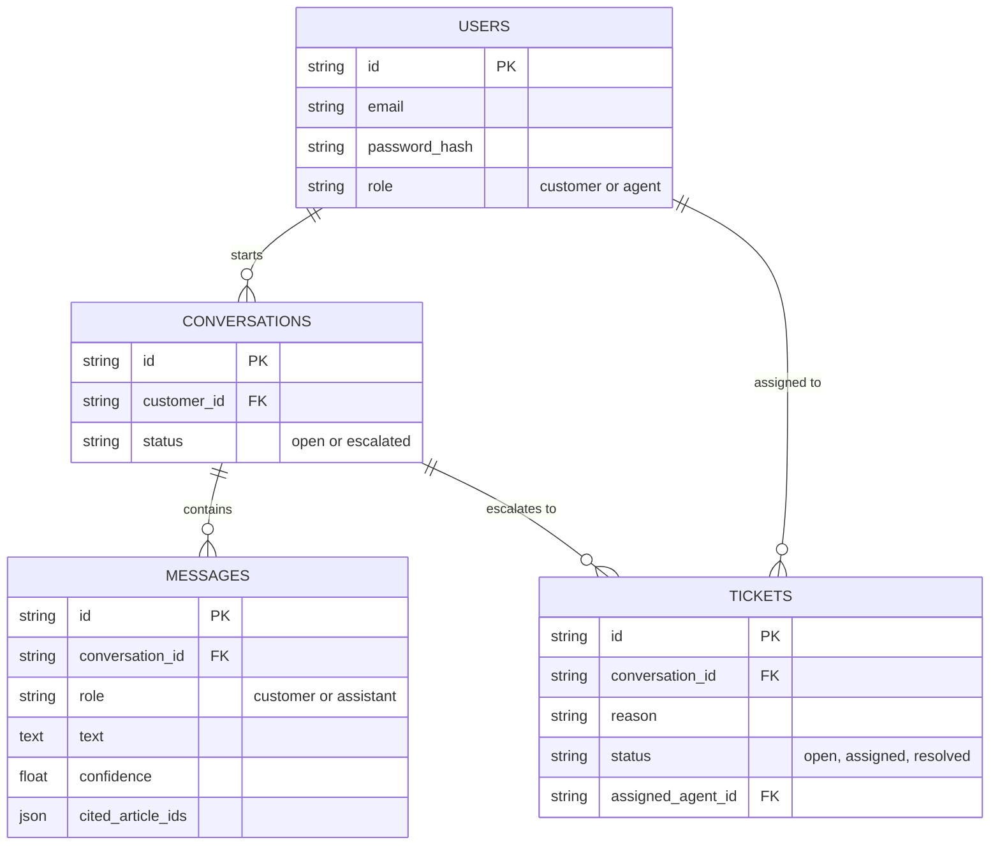

Author: Jacob Wills-Brennan

# Architecture

The Alpha is a modular monolith: one FastAPI application split into modules with clear
responsibilities. Modules talk to each other through typed classes (services and dataclasses),
not by reaching into each other's tables or internals, so any module can be replaced later
without rewriting the others.

## Module diagram

## Main flow

1. The customer logs in and gets a short-lived bearer token.
2. The customer sends a message. The conversation module saves it.
3. The AIOrchestrator checks for requests for a person or account changes, then asks the
   KnowledgeRetriever for the best approved article.
4. If the match is confident, the article is returned as the reply with its ID cited.
   Otherwise the EscalationService creates a ticket and the customer gets the ticket number.
5. Agents list tickets and move them from open to assigned to resolved.

If the AI layer throws an error, the conversation module catches it, gives the customer a safe
fallback reply, and creates a ticket, so a failure never reaches the customer as a crash.

## Data model

## Alpha scope compared to the full design

| Design component | Alpha | Final project |
|---|---|---|
| Presentation layer (customer web UI, agent console) | Not built; Swagger UI at `/docs` is used for demos | Customer chat UI and agent console |
| Auth and session module | Built | Refresh tokens, rate limiting |
| Conversation module | Built | Request ID deduplication |
| AI orchestration and retrieval | Built (TF-IDF retrieval) | Calibrated confidence, generated replies |
| Escalation / ticket module | Built | Agent queues and permissions |
| Feedback and offline evaluation | Test-set evaluation in CI | Feedback endpoint and review loop |
| CRM adapter | Not built | Permitted-field customer lookups |
| Task queue and load balancing | Not built | Queue workers, load testing |
| Database | SQLite, tables created at startup | PostgreSQL with migrations |
